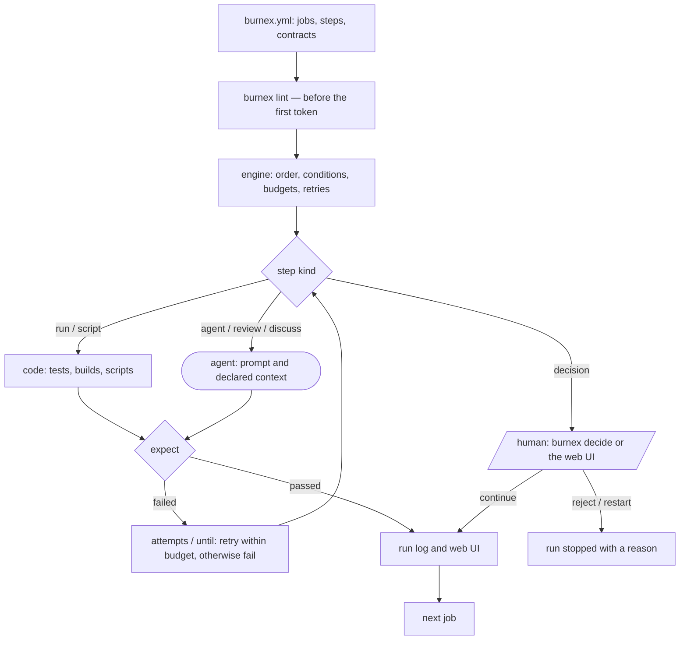

burnex is an engine that executes a pipeline from `burnex.yml`. A pipeline is a graph of **jobs**; a job is a sequence of **steps**. Each step is executed by one of three things: code, an agent, or a human. What happens next is decided by the engine from the declared graph, not by the model.

## Five ideas

**Control flow is deterministic.** The engine computes job order (`needs`), conditions (`if`, `on: failure`), parallelism, retries, and spend caps from the graph. The agent does what the current step asks and returns the result — it doesn't decide which step comes next.

**A step's result is checked by a contract.** A step declares `expect`: exit code, structured output schema, edit boundaries, a check command, and optionally a judge agent. A failed check fails the step; it isn't a cue to "carry on somehow". More in [Contracts](/burnex/en/concepts/contracts/).

**Retries are bounded.** `attempts` retries a step, `until` retries the whole job until a check like `npm test` passes. Both are capped by the number of attempts and by a budget of tokens, money, and time. More in [Retries and budgets](/burnex/en/concepts/retries-and-budgets/).

**Jobs exchange files; steps within a job share a conversation.** Each job returns one JSON, which is automatically added to the context of downstream agent jobs. Agent steps in the same job share a session by default. More in [Context](/burnex/en/concepts/context/).

**Nothing is hidden.** `burnex context` shows what a step will see, `burnex config` shows where each setting came from, the run log keeps the prompt, output, and spend of every attempt, and `burnex up` shows all of it in the browser. More in [Runs](/burnex/en/concepts/runs/).

## What's next

- [Pipeline and jobs](/burnex/en/concepts/pipeline/) — what `burnex.yml` is made of.
- [Step kinds](/burnex/en/concepts/steps/) — `run`, `agent`, `review`, `discuss`, `decision`, and more.
- [Agents and roles](/burnex/en/concepts/agents/) — Claude, Codex, and Cursor in one pipeline.
