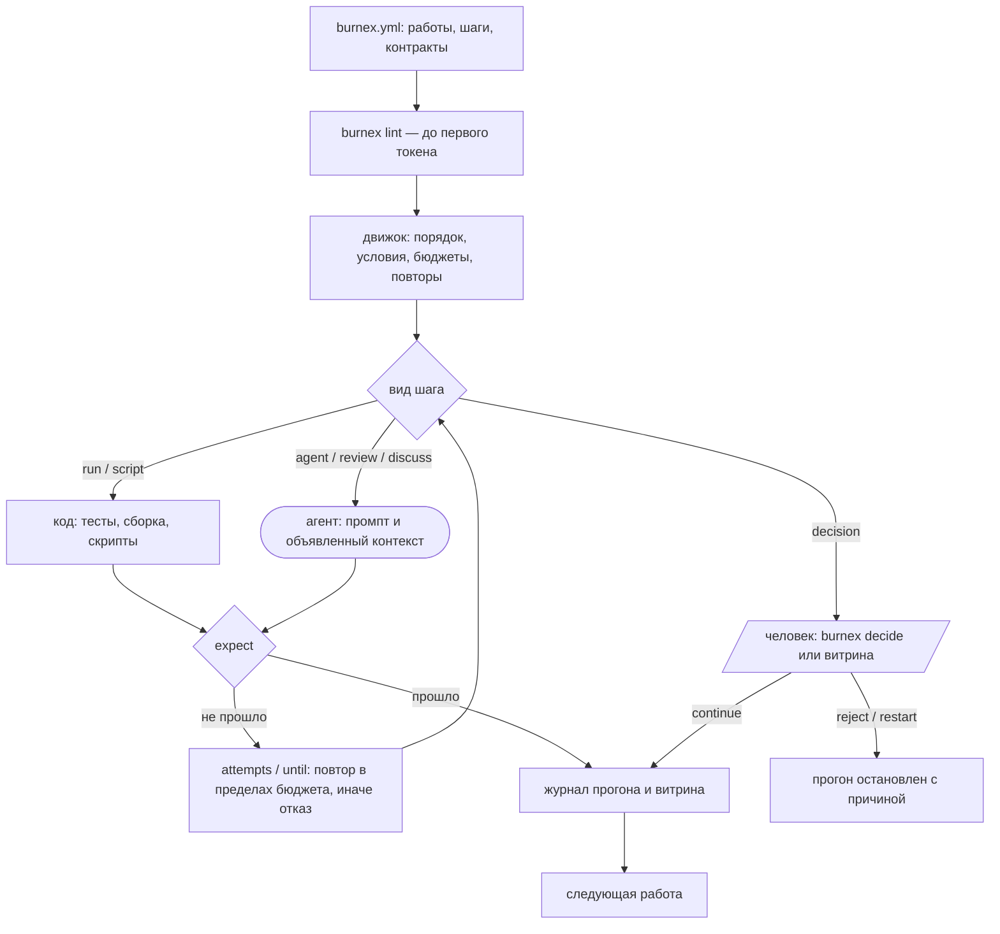

burnex — движок, который исполняет пайплайн из `burnex.yml`. Пайплайн — граф **работ**, работа — последовательность **шагов**. Шаг исполняет одно из трёх: код, агент или человек. Что делать дальше, решает движок по объявленному графу, а не модель.

## Пять идей

**Управление потоком детерминировано.** Порядок работ (`needs`), условия (`if`, `on: failure`), параллельность, повторы и потолки расхода движок вычисляет из графа. Агент делает то, что поручил текущий шаг, и отдаёт результат — он не решает, какой шаг следующий.

**Результат шага проверяется контрактом.** У шага объявлен `expect`: код возврата, схема структурированного вывода, границы правок, команда-проверка, по желанию — агент-судья. Непрошедшая проверка — отказ шага, а не повод «как-нибудь продолжить». Подробнее — [Контракты](/burnex/ru/concepts/contracts/).

**Повторы ограничены.** `attempts` повторяет шаг, `until` — работу целиком, пока не пройдёт проверка вроде `npm test`. И то и другое упирается в число попыток и бюджет токенов, денег и времени. Подробнее — [Повторы и бюджеты](/burnex/ru/concepts/retries-and-budgets/).

**Работы обмениваются файлами, шаги внутри работы — диалогом.** Каждая работа отдаёт один JSON, он автоматически попадает в контекст следующих агентских работ. Агентские шаги одной работы по умолчанию идут в общей сессии. Подробнее — [Контекст](/burnex/ru/concepts/context/).

**Ничего не скрыто.** `burnex context` показывает, что увидит шаг, `burnex config` — откуда взялась каждая настройка, журнал прогона хранит промпт, вывод и расход каждой попытки, `burnex up` показывает всё это в браузере. Подробнее — [Прогон](/burnex/ru/concepts/runs/).

## Что дальше

- [Пайплайн и работы](/burnex/ru/concepts/pipeline/) — из чего состоит `burnex.yml`.
- [Виды шагов](/burnex/ru/concepts/steps/) — `run`, `agent`, `review`, `discuss`, `decision` и другие.
- [Агенты и роли](/burnex/ru/concepts/agents/) — Claude, Codex, Cursor в одном пайплайне.
